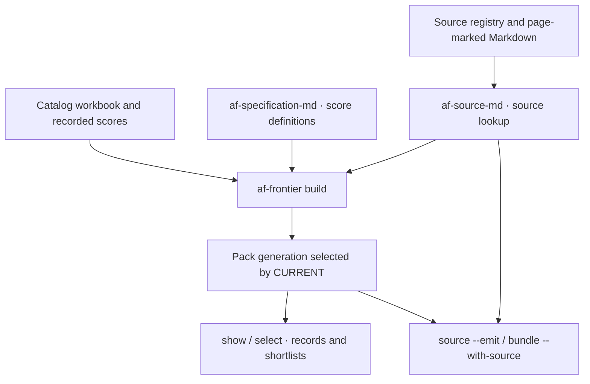

# af-frontier-pack

Which adventures in my library take little preparation and still give players
choices that matter? Frontier Pack lets you filter a scored AdventureFinder
catalog, open the book pages behind a match, and put the records you choose into
a Markdown or JSON file for comparison. All six commands run locally without a
model. You or ChatGPT can use the evidence to decide what to run.

A **pack** is a reusable index of the selected catalog and its source locations.
A **bundle** is a file you make from the pack for one question. It contains the
selected records and, when requested, their verified source excerpts. Building
a pack or bundle leaves your catalog and books alone.

## Try it with three public adventures

Follow the [public sample walkthrough](https://github.com/dtnorris/adventure-finder/blob/1a4be9e12ad02144993f945de8cee4cfa28a67be/README.md#try-the-public-sample)
in an empty directory. It includes the workbook and book pages, selects the
matching public tools and scoring definitions, and builds the pack. You need
Bash, Git, Ruby 3.2 or newer with RubyGems, `unzip`, and HTTPS access to GitHub
and RubyGems.

The sample applies two filters together: **GM Preparation Burden** (`GMPB <= 2`)
and **Consequential Player Agency** (`CPA >= 4`). One row matches:
**ADV-0001 · Adventure One**. Its source is **Book One, printed pages 10–11**.
Raising the agency threshold to 5 returns zero rows.

To take that result into a conversation, run this from the **same sample
directory** after the walkthrough finishes. The sample set its environment in
a child shell, so select its pack, gems and source reader again:

```bash
export GEM_HOME="$PWD/gems" GEM_PATH="$PWD/gems"
export AF_FRONTIER_OUTPUT="$PWD/pack" AF_SOURCE_MD_ROOT="$PWD/af-source-md"
./af-frontier-pack/bin/af-frontier bundle --ids ADV-0001 --with-source
```

Open `pack/bundles/ADV-0001.md`. Under **Structured record** you can inspect the
scores. Under **Canonical source evidence** you can read the two fixture pages.
A first question to ask with this public bundle is *Which parts of the low-prep,
high-agency selection can you verify from these two pages, and which depend on
the catalog assessment?* For a library with more candidates, the
[usefulness benchmark](docs/BENCHMARK.md) has questions about rediscovering
overlooked adventures and comparing adventures with similar scores.

**Using your own library?** Follow [Build and use a private Frontier pack](https://github.com/dtnorris/adventure-finder/blob/1a4be9e12ad02144993f945de8cee4cfa28a67be/docs/private-frontier-pack.md).
Bring the project-state manifest that selects your accepted catalog, the
workbooks it references, the matching source registry and Markdown files, and
an adventure ID. The guide selects the pinned public ontology. Keep bundles
containing private book text local.

## How the pack fits into AdventureFinder



The pack records where the source lives. Commands that include an excerpt
read the selected Markdown on disk. That lets you explore the scores first
and bring in just the pages needed for a decision.

## Commands

Run `bin/af-frontier help` from this repository for the CLI syntax. For an
existing pack, set `AF_FRONTIER_OUTPUT` to the directory containing `CURRENT`.
Use an adventure ID returned by your own `select` when working with a different
library.

| If you want to… | Use | Result |
| --- | --- | --- |
| Build from selected inputs | `build` | Publishes a verified pack generation. See [Build](#build) for prerequisites and selectors. |
| Check the pack and its inputs | `doctor` | Prints an integrity result and exits unsuccessfully on failure. |
| Inspect one adventure | `show ADV-0001 --format json` | One structured catalog record on stdout. |
| Find low-prep, high-agency matches | `select --where 'GMPB<=2' --where 'CPA>=4'` | Tab-separated IDs and titles. Add `--ids-only` for one ID per line. |
| Find or read the supporting pages | `source ADV-0001` | Prints the locator as JSON. Add `--emit` to print the exact excerpt. |
| Prepare a comparison | `bundle --ids ADV-0001` | Writes a Markdown file and prints its path. Use `--format json` for JSON or `--with-source` to include excerpts. |

To automate a comparison, pipe `select --ids-only` into `bundle --ids -` when there are
matches. An empty shortlist is a valid result. Stop there or revise the filter:
`bundle` requires at least one ID. Missing scores remain unknown and do not
satisfy a numeric filter. Use the source locator to cite the book and pages.

## Build

Run the commands below from this repository with Ruby 3.2 or newer, REXML
3.4.4 and `unzip` available. Use the [private walkthrough](https://github.com/dtnorris/adventure-finder/blob/1a4be9e12ad02144993f945de8cee4cfa28a67be/docs/private-frontier-pack.md)
for a complete setup from scratch.

Build from a deliberately selected library without `AF_PROJECT_ROOT` or
`AF_FRONTIER_AMC`:

```bash
unset AF_PROJECT_ROOT AF_FRONTIER_AMC
export AF_SOURCE_MD_ROOT=/absolute/path/to/af-source-md
export AF_FRONTIER_OUTPUT=/path/to/selected/frontier-pack
bin/af-frontier build \
  --state /path/to/selected/catalog/PROJECT_STATE.yml \
  --source-registry /path/to/selected/corpus/source_registry.yml \
  --corpus-root /path/to/selected/corpus \
  --public-afao /path/to/af-specification-md/AdventureFinder_Analysis_Ontology_AFAO_v1.6.1.md
bin/af-frontier doctor
```

Replace the example locators with existing inputs. For deliberate historical
ontology selection use `--afao /path/to/frozen/ONTOLOGY.md` instead of
`--public-afao`. For historical/frozen catalog work, replace `--state PATH` with
`--amc /path/to/5e_Adventure_Master_Catalog_X.Y.xlsx`; this is artifact selection,
not accepted-state resolution.

With `AF_PROJECT_ROOT` configured, `bin/af-frontier build` instead uses the
configured relative state and ontology authorities, the default corpus beneath
that root, and its `source_registry.yml`. Each explicit selector overrides only
its own default.

The production source registry contract is `adventurefinder-source-registry/v0.1`. Explicit mappings may point to one Markdown file or to page-bounded segments. `page_marker_offset`, when present, must be an explicitly signed integer string such as `"+3"` or `"-4"`. If a source has no explicit registry entry, the same deterministic normalized-filename fallback used by the public scorer is available and is surfaced with a warning. Ambiguity fails closed.

Builds and source-bearing output use [af-source-md](https://github.com/dtnorris/af-source-md/tree/a44019961e822b19a727e3562c2ecda4cfe0a7bd) for registry resolution and raw page slicing. Set `AF_SOURCE_MD_ROOT` to the absolute path of that owner checkout, or make `af_source_md` available on Ruby's load path when the selector is absent. An invalid explicit selection refuses the operation. Keep the owner selection fixed for the life of the process.

Frontier Pack validates all registry entry shapes at build time and keeps its existing locator fields, including canonical segment bounds. `source --emit` and source-bearing bundles require exact page boundaries, strip trailing whitespace from the raw slice, and append one newline. Metadata-only commands can read existing packs without loading the owner.

## Deterministic filtering

`select` is deliberately boring. v0.1 supports only repeated AND-ed comparisons:

```bash
bin/af-frontier select \
  --where 'GMPB<=2' \
  --where 'CPA>=4'
```

Operators:

```text
= != < <= > >=
```

No OR, fuzzy matching, preference scoring, natural-language parsing, or semantic ranking belongs here.

For composition:

```bash
bin/af-frontier select \
  --where 'GMPB<=2' \
  --where 'CPA>=4' \
  --ids-only \
| bin/af-frontier bundle --ids -
```

`select --ids-only` writes only Adventure IDs to stdout; pack authority/status goes to stderr.

## Source resolution

```bash
bin/af-frontier source ADV-0001
```

returns the deterministic locator. `--emit` follows the production AdventureFinder source contract: it uses `Printed Page` markers when a source contains them, otherwise falls back to `PDF Page` / `PAGE:` markers, and applies the registry's `page_marker_offset` before requiring exact start/end markers. Missing or ambiguous boundaries fail closed; there is no full-source fallback in `af-frontier-pack`.

## Bundle

Bundles default to the pack's `bundles/` directory. Use `--output PATH` on
the bundle command to choose a filename. File-producing bundles print the
absolute output path. Source-bearing bundles should remain uncommitted.

## Build and storage reference

Use this reference to check which [catalog](#canonical-amc-resolution) and
[ontology](#afao-resolution) a build selected, how [paths](#project-root) resolve,
or how to [read a published generation](#output).

### Canonical AMC resolution

The Adventure Master Catalog (AMC) is the scored workbook. An explicit workbook
selection takes precedence:

```bash
bin/af-frontier build --amc /path/to/5e_Adventure_Master_Catalog_X.Y.xlsx
```

If both `--amc` and `AF_FRONTIER_AMC` are absent, the CLI resolves the authoritative `catalog_head` from a project-state manifest and **prints the exact resolved file before building**. It never treats the numerically largest filename as canonical.

Resolution order in v0.1:

1. `--amc PATH`
2. `AF_FRONTIER_AMC`
3. `--state PATH`, resolving role `catalog_head`
4. `config/authority.yml` → `state_manifests` (currently `af-xlsx-files-data/PROJECT_STATE.yml`, relative to an explicitly configured `AF_PROJECT_ROOT`)

The production project-state contract is `adventurefinder-project-state/v0.2`. For a resolved `catalog_head`, `af-frontier` validates all three roles, including separate `matcher_authorized_baseline` and `production_dependency_floor` bindings, and verifies version/filename, byte size, and SHA-256 before building. Explicit `--amc` / `AF_FRONTIER_AMC` selects a frozen artifact; it does not establish library acceptance. If no authoritative head can be resolved, the command fails closed and asks for `--amc` or a project-state manifest.

### AFAO resolution

The AdventureFinder Analysis Ontology (AFAO) is required because `adventures.jsonl` exposes fields whose meanings come from the ontology. A normal build selects the configured public identity without scanning for newer filenames or falling back to private specifications.

Resolution order in v0.1:

1. `--public-afao PATH` for the pinned public identity, **or** `--afao PATH` for deliberate historical/frozen input
2. `config/authority.yml` → `afao` when neither explicit selector is supplied

The current configured contract is:

```text
af-specification-md/AdventureFinder_Analysis_Ontology_AFAO_v1.6.1.md
version: 1.6.1
source revision: 394a44c2c2052ce2eeb6d28cd7647ad8a50acfcf
sha256: dcfad224ab9517272504a508f935a804032d04a7c812ede10498921ce4585fa1
bytes: 339101
```

The source is [`dtnorris/af-specification-md`](https://github.com/dtnorris/af-specification-md/tree/394a44c2c2052ce2eeb6d28cd7647ad8a50acfcf), bound to its reviewed `documents.json` inventory. `AnalysisOntologyResolver::PUBLIC_AFAO` pins the expected identity independently of supplied bytes. The configured path is relative to `AF_PROJECT_ROOT` unless absolute; `--public-afao` selects an existing file at any explicit location with the exact basename, declared version, digest and size. Only the AFAO file is required, without a runtime Git/network lookup or the other seven documents. The recorded revision identifies the source of the pinned bytes; it does not attest the local checkout's HEAD.

Missing, incompatible or changed public inputs fail before replacing `CURRENT`. The builder rechecks the pin at consumption. No alias, private fallback or automatic adoption of a different revision is provided. AFAO 1.6.1 remains **Candidate**, pending targeted GM Preparation Burden 4/5 revalidation; selection does not establish method acceptance or model qualification.

`--afao` retains its existing explicit input behavior: require a declared version and record the supplied bytes without asserting the public pin. It overrides configured authority and remains usable for historical versions and legacy locations. Supplying both selectors is an error. Existing custom historical authority configurations retain their filename/version checks.

`manifest.json` records the resolved AFAO filename, absolute path, declared version, SHA-256 and byte size. Public selections additionally record `inputs.afao.public_specification` with repository, source revision and repository-relative path. Existing pack reads retain their behavior; `doctor` checks recorded input hashes without requiring a build-time project root.

### Project root

There is no implicit project root. With fully selected build inputs, leave
`AF_PROJECT_ROOT` unset. Missing or blank means unconfigured; Frontier Pack never
discovers a library from cwd, home, or a developer's personal directories.

Set `AF_PROJECT_ROOT` only when using relative paths from `config/authority.yml`
or the default corpus `af-source-md-data` beneath that root:

```bash
export AF_PROJECT_ROOT=/path/to/existing/components
bin/af-frontier build
```

An existing installation can deliberately retain its legacy location, for example
`export AF_PROJECT_ROOT=/Users/davidnorris/code` if that directory contains the
configured sibling layout. This selects existing paths; it moves or initializes
nothing. Missing/invalid required roots fail with configuration guidance. An
unused root does not affect explicit inputs or existing pack reads.

Explicit CLI paths remain relative to the invoking cwd unless absolute. State
filenames are relative to their manifest; registry file mappings are relative to
the selected corpus. The registry defaults to `source_registry.yml` inside that
corpus. An invalid explicit operand fails without selecting another library.

`help`, `version` and existing pack commands require no build-time root.
`--output` wins over `AF_FRONTIER_OUTPUT`; otherwise output defaults beneath
this code checkout. Set `AF_FRONTIER_OUTPUT` for subsequent pack reads (or use
`doctor --root PATH`).

### Output

The canonical pack is written to:

```text
output/frontier-pack/
├── CURRENT
├── generations/
│   └── generation-<unique-id>/
│       ├── manifest.json
│       ├── adventures.jsonl
│       └── sources.jsonl
└── bundles/
```

Builds validate the input descriptors, catalog records, and source bindings with
the existing `doctor` rules before publication. Unresolved sources retain their
existing explicit unresolved status. Complete artifacts are written privately on
the same filesystem; one atomic replacement of `CURRENT` selects the generation.
Its manifest records SHA-256 hashes for both JSONL files, and `CURRENT` records
the manifest hash. Manifest and JSONL bytes remain deterministic across identical
builds; generation names and pointer bytes are intentionally unique.

`Pack.new(root: ...)` binds once and loads all three verified artifacts before
returning. Reuse that instance for related reads; `root` remains the output root,
and `artifact_root` identifies its selected generation. `Paths.manifest_path`,
`adventures_path`, and `sources_path` resolve the current verified generation.
Missing, malformed, or mismatched artifacts raise `IntegrityError` without a
fallback to another generation. CLI commands and source resolution use this same
reader. Authority files and source Markdown must remain stable during a build.

Legacy flat roots have no verifiable generation and require `build` before use.
A successful rebuild creates `CURRENT` without modifying the old flat files;
those files are ignored thereafter. External file consumers must resolve one
generation rather than reading the old flat paths.

An interruption before replacing `CURRENT` leaves the previous generation
selected; on the first build it leaves no usable pack. After replacement, the
new generation is committed even if the writer subsequently reports an error.
Previous generations remain usable by bound readers. Builds never delete
published generations or another writer's files; abandoned staging directories
can remain after abrupt process exit. Reclaim old output only when all readers
and writers have stopped. Atomic visibility assumes local filesystem rename
semantics; it does not promise persistence through power loss.

Every file-producing `bundle` command ends by printing its **absolute output path**. When stdout is reserved for machine-readable content, human status is written to stderr so Unix pipelines stay clean.

### Reviewed two-volume source references

If a catalog entry was assessed using two specific volumes together, and its
canonical range intersects two separate registry segments, the operator can
retain both reviewed references with `--reviewed-source PATH`. Use a private
JSON file for one catalog entry. Match the catalog ID, adventure title, source
book and integer page bounds. Use the exact `file` values from the selected
registry as keys and the lowercase SHA-256 of each reviewed file as values
(`shasum -a 256`). For example, the synthetic campaign fixture uses

```json
{
  "adventure_id": "ADV-0004",
  "adventure_title": "Example Campaign",
  "source_book": "Book Two",
  "start_page": 17,
  "end_page": 25,
  "files": {
    "volume-one.md": "a3b15cd32588467aff1b2eea74296bae66675d2b54a96189301063aa85055203",
    "volume-two.md": "1067b2ba6072a206d650a94381a8209707542558476e47f78153e068d09fc5c2"
  }
}
```

```bash
export AF_FRONTIER_OUTPUT=/path/to/selected/frontier-pack
bin/af-frontier build \
  --state /path/to/selected/catalog/PROJECT_STATE.yml \
  --source-registry /path/to/selected/corpus/source_registry.yml \
  --corpus-root /path/to/selected/corpus \
  --public-afao /path/to/af-specification-md/AdventureFinder_Analysis_Ontology_AFAO_v1.6.1.md \
  --reviewed-source /path/to/private/review.json
bin/af-frontier doctor
```

Frontier checks for exactly two nonoverlapping registry segments intersecting
the catalog range, two distinct files and matching digests before publishing.
The locator lists both files, digests and registry bounds under
`source_references`. The bounds describe the registry mapping and may leave
gaps in the catalog span. The catalog values are preserved, and the locator's
`exact_excerpt: false` reports that there is no verified single-file excerpt
for the parent. `show`, `select`, `source` metadata and metadata-only bundles can
include the entry. `source --emit` and `bundle --with-source` refuse its exact
excerpt. Each child keeps its own ordinary locator. Counts of resolved
adventures still measure single-file locators, so the parent contributes to
`source_unresolved`. The declaration is a build input. `doctor` checks the
retained references against the pack's source index and the files on disk.

## Invariants

- Zero canonical truth ownership.
- Same authoritative inputs + same generator version => same semantic pack.
- Explicit artifact selection or authoritative `catalog_head` resolution only.
- Every pack records a concrete AFAO authority; `inputs.afao` is never `null`.
- Never infer canonicality from filename version ordering.
- Missing assessment values remain `null`; missing never means low.
- No LLM calls for build/doctor/show/select/source/bundle.
- No hidden semantic proxies.
- Fail closed on identity/source ambiguity.
- Source prose is not copied into the canonical pack.
- Task bundles are convenience artifacts, not authorities.

## Explicit v0.1 non-goals

No embeddings, vector database, SQLite retrieval layer, hosted service, API, MCP server, web UI, LLM provider integration, recommendation engine, AFPS/AFMRS replacement, semantic similarity ranking, generated summaries/tags, ontology expansion, or permanent copied copyrighted corpus.

See the [product specification](docs/PRODUCT_SPEC.md) for scope and the [integration notes](docs/INTEGRATION_NOTES.md) for catalog selection, page mappings and the limits of parentage data.

## Development

```bash
bundle install
AF_SOURCE_MD_ROOT=/absolute/path/to/af-source-md bundle exec rake
```

For reproducible tests and CI, use the public `dtnorris/af-source-md` checkout at
`a44019961e822b19a727e3562c2ecda4cfe0a7bd` with Ruby 3.2 or newer. Provision the
checkout before running the suite. Tests use that same owner selection as `build`.

The test fixture includes a tiny `.xlsx`, production-schema source registry, and safe Markdown corpus so the core v0.1 flow can be exercised without copying any private AdventureFinder source content.
